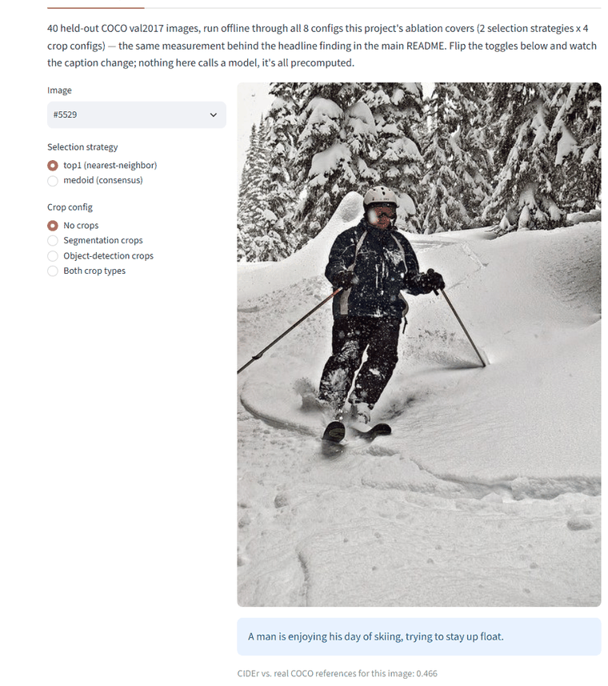
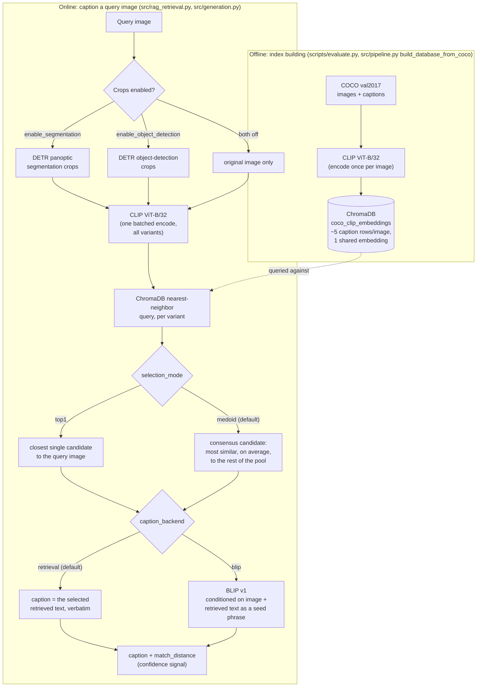

# RAG Image Captioning

[](https://rag-image-captioning-fxxzqkhwjuqyx5s6rthwxj.streamlit.app/) [](https://codespaces.new/AntiVicious/rag-image-captioning)

Retrieval-augmented image captioning: CLIP embeddings and ChromaDB retrieval
over COCO captions. Optional DETR segmentation or object-detection crops split
an image into regions before retrieval, and an optional BLIP model can
generate a caption conditioned on the retrieved text.

**[Live demo](https://rag-image-captioning-fxxzqkhwjuqyx5s6rthwxj.streamlit.app/)**: a gallery of 40 held-out images under all 8
ablation configurations, plus an "Upload your own" tab. The demo runs on
Streamlit's free tier and may take a minute to wake up. See
[`demo/README.md`](demo/README.md) for how it differs from the full pipeline.

## Main Result

**How the retrieved candidates are chosen matters as much as what is
retrieved.** Results on a held-out split of COCO val2017 (N = 200), with
output length held constant (full table and commands in
[`results/README.md`](results/README.md)):

<p align="center">
  
  <br>
  <sub>Same image and index; only the selection strategy and crop configuration change.</sub>
</p>

| Selection → | top1 (nearest neighbour) | medoid (consensus) |
|---|---|---|
| no crops | 0.469 CIDEr, 0.28 s/image | 0.486 CIDEr, 0.47 s/image |
| **+ segmentation crops** | 0.422 CIDEr, 10.43 s/image | **0.537 CIDEr, 10.46 s/image** |
| + object-detection crops | 0.406 CIDEr, 2.75 s/image | 0.506 CIDEr, 3.46 s/image |
| + both crop types | 0.395 CIDEr, 11.87 s/image | 0.512 CIDEr, 12.84 s/image |

- **top1** returns the caption of the image closest to the query.
- **medoid** returns the candidate whose CLIP text embedding is, on average,
  most similar to the other candidates (about 20 lines of code).

Under top1, crops make results worse: extra candidates compete for "closest
to the query", and DETR's small single-object crops drift from the
whole-scene captions COCO uses. A control with six large random crops scores
0.479, about the same as no crops. Under medoid, the same crops improve
results, because a larger, more varied pool gives a better consensus.

**Default configuration:** medoid selection with segmentation crops, the
best score measured (+14.5% CIDEr over top1 without crops). Turning crops off
(`--skip-detr` or `enable_segmentation=False`) gives 0.486 CIDEr at
0.47 s/image, for when DETR's ~10 s/image cost is too high.

These CIDEr values are low compared with trained captioning models
(typically above 1.2 on COCO) because this system returns existing captions
from other images rather than generating new ones; the comparison of
interest is between retrieval strategies.

## Out-of-Distribution Images

COCO is skewed towards Western scenes. I collected about 12,500
Indian-context images (a CC0 food dataset and a Wikimedia Commons scrape
across 18 categories such as festivals, temples, weddings and street life),
added them to the index, and compared retrieval before and after on a
held-out sample of 200 images:

- **Before:** Indian-context images retrieve with **56% higher** nearest-
  neighbour distance than COCO images.
- **After:** their distance is **19.5% lower** than COCO's baseline. Part of
  this comes from the Indian set's narrower scope (33 categories against
  COCO's 80), so it shows the augmentation worked rather than that these
  images are now easier than COCO.
- **Against 53 hand-written reference captions:** BLEU-4 0.012 → 0.018,
  METEOR 0.047 → 0.081, ROUGE-L 0.154 → 0.182, CIDEr 0.113 → 0.288. These
  references differ from COCO's, so the CIDEr values aren't comparable with
  the table above. 53 images is still a small sample.

About 46% of the Indian images had a near-duplicate elsewhere in the set,
mostly in the food dataset. Near-duplicates were excluded from the
candidate pool when measuring; without that correction the improvement
appears as 62% instead of 19.5%.

## Evaluation Pitfalls

Several numbers in this project were wrong at first and were corrected
before publishing. The general lessons:

1. **Hold every other variable constant.** Concatenating the captions from
   every crop into one block made CIDEr collapse to about 7×10⁻¹⁰ because
   the output was much longer, not because the captions were worse. The fix
   was to compare one selected caption per configuration.
2. **Exclude everything identical to the query, not just the query.** A
   99% Recall@K came from queries finding their own embedding in the index.
   The same leak appeared in a quantization test (each COCO image has about
   5 caption rows sharing one embedding) and in the out-of-distribution
   test (near-duplicate twins).
3. **Check what population a sample actually comes from.** One
   distribution-shift run sampled only the food subset, leaving out the
   7,768 Wikimedia Commons images.
4. **Make sure a metric is defined for the task.** With queries properly
   held out, COCO has no cross-image relevance labels, so Recall@K has no
   meaningful value here. The claim was withdrawn.
5. **Measure savings in the real storage layer.** fp16/int8 memory savings
   computed on numpy arrays don't apply to ChromaDB, which stores float32
   internally.
6. **Define exactly what a percentage counts.** A single "8.45% changed"
   figure mixed top-10 set changes (0.35%) with top-1 changes. The top-1
   rate first came out at an impossible 76.5% because an unstable sort broke
   exact similarity ties differently; with deterministic tie-breaking it is
   1.5%, and those flips don't change caption scores.

Details are in [`results/README.md`](results/README.md).

## Architecture

CLIP encodes the image and, if enabled, its DETR crops. ChromaDB returns the
nearest captions for each variant. `Config.selection_mode` picks one caption
from the pool: `"medoid"` (default) or `"top1"`. The caption is returned as
is (`caption_backend="retrieval"`, the default, no GPU needed) or passed to
BLIP base (~247M parameters, runs on CPU) as a text prompt
(`caption_backend="blip"`).



## Running with Docker

```bash
docker build -t rag-image-captioning:local .

# Build the index from COCO val2017 (~1 GB, 5,000 images). Mount coco/ and
# chroma_db/ so the index persists on the host.
docker run --rm \
  -v "/path/to/coco:/app/coco" \
  -v "/path/to/chroma_db:/app/chroma_db" \
  rag-image-captioning:local \
  python -m src.cli --coco-img-dir ./coco/val2017 \
    --coco-ann-file ./coco/annotations/captions_val2017.json build-db

# Run the Streamlit app
docker run --rm -p 8501:8501 \
  -v "/path/to/chroma_db:/app/chroma_db" \
  rag-image-captioning:local
```

**Windows:** ChromaDB's native insert/query path crashes with an access
violation on at least one Windows machine, even with an in-memory client
([chroma-core/chroma#3058](https://github.com/chroma-core/chroma/issues/3058)).
Use Docker on Windows.

**WSL2 memory:** without a `.wslconfig`, WSL2 is limited to half of the
host's RAM, which may not be enough to load CLIP and DETR together (the
container exits with code 137). Raise the limit in
`%USERPROFILE%\.wslconfig`, then run `wsl --shutdown` and restart Docker
Desktop:

```ini
[wsl2]
memory=11GB
```

## Reproducing the Numbers

```bash
# Ablation table. The eval image adds a JRE for pycocoevalcap's METEOR.
docker build -f Dockerfile.eval -t rag-image-captioning:eval .
docker run --rm \
  -v "/path/to/coco:/app/coco" \
  -v "/path/to/chroma_db:/app/chroma_db:ro" \
  -v "/path/to/eval_output:/app/eval_output" \
  rag-image-captioning:eval python scripts/evaluate.py \
    --num-eval-images 200 --seed 42 \
    --coco-img-dir /app/coco/val2017 \
    --coco-ann-file /app/coco/annotations/captions_val2017.json \
    --source-chroma-db /app/chroma_db --out /app/eval_output/eval_results.json

# Distribution shift (Indian-context images, before/after augmentation)
docker run --rm \
  -v "/path/to/chroma_db_augmented:/app/chroma_db_augmented" \
  -v "/path/to/chroma_db_before:/app/chroma_db_before" \
  -v "/path/to/dist_shift_output:/app/dist_shift_output" \
  rag-image-captioning:eval python scripts/measure_distribution_shift_v2.py
```

Summary CSVs are in [`results/`](results/); the raw per-image outputs are
not committed.

## Known Issues

- **ChromaDB on Windows:** use Docker (see above).
- **`transformers` is pinned to 4.46.3** because of two upstream issues with
  `DetrForSegmentation.from_pretrained("facebook/detr-resnet-50-panoptic")`:
  - 5.x loads the model but then grows past 10 GB of memory and is killed.
  - 4.44.0 and earlier fail with `ValueError: dictionary update sequence
    element #0 has length 1; 2 is required`, fixed in
    [huggingface/transformers#34010](https://github.com/huggingface/transformers/pull/34010)
    (4.46.0).
- **Small validation sample:** the hand-labelled out-of-distribution
  evaluation uses 53 images. Around 150 would give a stable corpus-level
  CIDEr.
